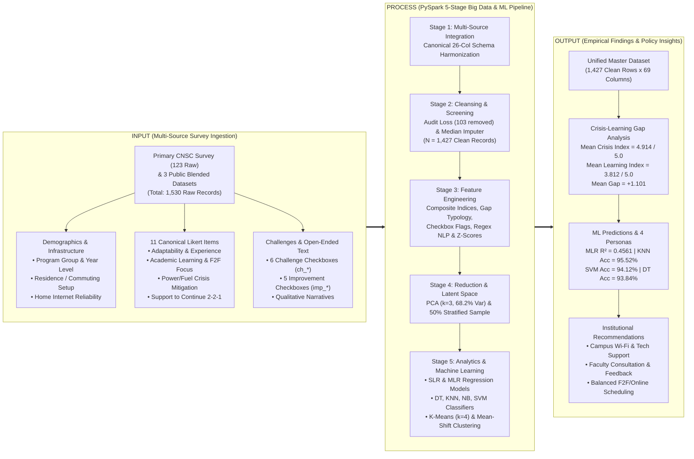

# CHAPTER I: INTRODUCTION

**Study Title:** *Perceptions of College Students Toward Blended Learning as a Response to Power Fuel Crisis*  
**Course:** BSIT 3A – IT 119: Data Scalability and Analytics  
**Researchers:** Johann Jethro O. Chavez, Mikylla Nicole M. Nañez, Divine Mae S. Ponciano  
**Institution:** Camarines Norte State College (CNSC), Daet, Camarines Norte, Philippines  

---

## 1.1 Background of the Study

Higher education institutions (HEIs) in developing economies increasingly confront external macroeconomic and environmental disruptions—ranging from geopolitical fuel price shocks and regional electrical grid strains to severe climatic events. In early 2026, escalating global fuel prices and elevated regional power demand prompted state colleges and universities in the Philippines, including Camarines Norte State College (CNSC), to implement a **2-2-1 blended learning schedule** (comprising two days of in-person face-to-face instruction, two days of synchronous online classes, and one day of asynchronous self-directed learning) as an institutional resource-conservation measure (Garrison & Kanuka, 2004; Zimmerman, 2002).

The dual objective of the 2-2-1 blended learning policy is clear: first, to curtail institutional electricity consumption across campus classrooms, laboratories, and air-conditioning facilities; and second, to alleviate the daily commuting and fuel expenditure burden borne by college students and their households. However, while the administrative rationale for energy and fuel conservation is compelling, the pedagogical and behavioral impact of shifting from full face-to-face instruction to a three-mode weekly rotation remains a complex empirical question.

College students in provincial state universities navigate distinct socioeconomic and infrastructural realities. Many commute from rural municipalities or reside in off-campus boarding houses and dormitories with unstable cellular data reception and intermittent household electricity (Irwanto, 2024; Le et al., 2026). Switching rapidly between two days of campus classes, two days of synchronous video lectures, and one day of asynchronous module completion demands high self-regulated learning (SRL) capacity, reliable home internet connectivity, and sustained academic motivation. Consequently, an empirical tension frequently emerges—termed in this study the **Crisis–Learning Gap**: **students may strongly endorse the 2-2-1 blended modality as an effective macroeconomic response to the power and fuel crisis while simultaneously struggling with reduced lesson comprehension, screen fatigue, and weaker academic focus during online and asynchronous days**.

In the academic discipline of **Data Scalability and Analytics (IT 119)**, evaluating student perceptions and predicting support for continuing institutional policies requires moving beyond isolated, small-sample manual spreadsheets ($N < 150$). Small single-campus samples limit statistical power and restrict multi-dimensional machine learning segmentation across academic programs, year levels, living arrangements, and internet reliability tiers. Modern data science provides distributed computational frameworks capable of harmonizing primary local survey data with large-scale, open-access international and national educational datasets.

This study—**"Perceptions of College Students Toward Blended Learning as a Response to Power Fuel Crisis"**—investigates college students' modality adaptability, perceived academic learning effectiveness, perceived power and fuel crisis mitigation, and overall support for continuing the 2-2-1 blended learning schedule across a unified, multi-source master dataset (**$N = 1,427$ clean valid records** harmonized from **$1,530$ raw entries**). Anchored on our primary Google Forms survey at Camarines Norte State College ($123$ raw $\to$ $117$ cleaned records) and integrated with three open-access public datasets—Le et al. (2026) Vietnam blended learning perceptions survey ($580$ raw $\to$ $508$ valid), Irwanto (2024) Indonesia self-regulated blended learning survey ($577$ raw $\to$ $573$ valid), and Universitas Negeri Makassar (2021) online and blended learning survey ($250$ raw $\to$ $229$ valid)—this study executes a 5-stage **Apache PySpark** data engineering pipeline alongside **six supervised machine learning algorithms** and **two unsupervised clustering algorithms**.

---

## 1.2 Statement of the Problem

While the 2-2-1 blended learning modality was instituted to reduce campus electricity usage and student commuting costs during the power and fuel crisis, its effects on student comprehension, academic tracking, and modality satisfaction require rigorous empirical evaluation.

Specifically, this study addresses the following research questions:

1. **What is the demographic and infrastructural profile of the respondents** in terms of:
   - 1.1. Academic program / discipline group (`program_group`);
   - 1.2. Academic year level (`year_level` / `year_num`);
   - 1.3. Current residence / living arrangement (`residence_group`: *At home (commuting)*, *Dormitory/Near campus*, or *Apartment/Boarding house*); and
   - 1.4. Home internet reliability (`internet_group` / `internet_num`: *No/unreliable home internet*, *Somewhat reliable*, or *Very reliable*)?

2. **What are the perceptions of college students toward the 2-2-1 blended learning modality** across the 11 canonical 5-point Likert items grouped into four core dimensions:
   - 2.1. **Modality Experience & Adaptability**: Overall experience (`overall_experience`), schedule fit (`schedule_fit`), and comfort transitioning across F2F, online, and asynchronous days (`transition_comfort`), summarized by the composite `adaptability_index`;
   - 2.2. **Academic Learning & Performance**: Lesson understanding (`understanding`), staying on track with requirements (`stay_on_track`), preference for face-to-face focus (`f2f_focus`), and perceived academic performance (`academic_performance`), summarized by the composite `learning_index`;
   - 2.3. **Power & Fuel Crisis Mitigation**: Perceived reduction in school electricity consumption (`reduce_electricity`), reduction in household fuel/transportation expenses (`reduce_fuel`), and overall crisis effectiveness (`crisis_effectiveness`), summarized by the composite `crisis_index`; and
   - 2.4. **Policy Continuation Support**: Support for continuing the 2-2-1 blended learning modality in its current form (`support_continue` and categorical `support_category`)?

3. **Is there a statistically significant empirical gap between perceived crisis mitigation effectiveness and perceived academic learning effectiveness** (`crisis_learning_gap = crisis_index - learning_index`), and how are students distributed across the **Gap Typology** (*Aligned*, *Crisis-Effective but Learning-Struggling*, *Learning-Adapted beyond Crisis Rating*)?

4. **How do composite perception indices and continuation support vary across key student subgroups**, specifically by home internet reliability, residence/commuting arrangement, year level, and academic program?

5. **Using Supervised Machine Learning and Unsupervised Clustering, what predictive models and student behavioral personas emerge** to forecast continuation support (`support_continue` / `support_category`) and segment the student body?

6. **What specific multi-select challenges (`ch_*`), institutional improvement priorities (`imp_*`), and open-ended qualitative themes (`c_*` and `s_*`)** are reported by college students under the 2-2-1 schedule?

---

## 1.3 Objectives of the Study

### General Objective
To evaluate, model, and segment college students' perceptions toward the 2-2-1 blended learning modality as an institutional response to the power and fuel crisis using a 5-stage Apache PySpark big-data pipeline, supervised machine learning regression and classification models, and unsupervised clustering algorithms across a multi-source dataset ($N = 1,427$).

### Specific Objectives
1. **To harmonize and cleanse** the primary CNSC student survey ($123$ raw, $117$ valid) with three related public blended learning datasets into a unified master dataset ($1,530$ raw $\to$ $1,427$ clean records) using Apache PySpark.
2. **To quantify composite construct indices** for Academic Learning (`learning_index`), Schedule & Transition Adaptability (`adaptability_index`), Power/Fuel Crisis Mitigation (`crisis_index`), and the Crisis–Learning Gap (`crisis_learning_gap`).
3. **To examine subgroup differences and bivariate Pearson correlations** connecting internet reliability, residence setup, and construct indices to student endorsement of continuing the 2-2-1 modality (`support_continue`).
4. **To train and evaluate six Supervised Machine Learning models**—Simple Linear Regression (SLR), Multiple Linear Regression (MLR), Decision Tree Classifier, $K$-Nearest Neighbors (KNN), Gaussian Naive Bayes, and Support Vector Machine (SVM)—to predict continuous continuation support (`support_continue`) and classify respondents into support tiers (`Not supportive`, `Neutral`, `Supportive`).
5. **To discover latent student personas** using Unsupervised Machine Learning—$K$-Means clustering ($k = 4$) and non-parametric Mean-Shift density mode-seeking—projected into 2D Principal Component Analysis (PCA) latent space.
6. **To analyze multi-select modality challenges and open-ended text narratives** using PySpark regular-expression (`rlike`) keyword coding to formulate actionable policy recommendations for university administrators.

---

## 1.4 Conceptual Framework

This study integrates the **Community of Inquiry (CoI) Blended Learning Framework** (Garrison, Anderson, & Archer, 2000), **Self-Regulated Learning (SRL) Theory** (Zimmerman, 2002; Irwanto, 2024), and an **Input–Process–Output (IPO)** data engineering architecture.

---

## 1.5 Significance of the Study

- **College Students**: Voices student experiences regarding internet barriers, screen fatigue, asynchronous workload, and household fuel savings, ensuring policy adjustments reflect learner realities.
- **University Administrators (CNSC & Philippine HEIs)**: Provides quantitative evidence showing which courses and student groups benefit from the 2-2-1 schedule and where infrastructure investments (campus Wi-Fi, asynchronous learning materials, laboratory scheduling) are urgently required.
- **Faculty Members and Instructional Designers**: Highlights the importance of structured asynchronous learning materials and active teacher-student communication when in-person contact hours are compressed.
- **Energy and Education Policymakers (CHED & DOE)**: Quantifies the perceived effectiveness of flexible learning schedules as a demand-side energy and transport fuel conservation measure during macroeconomic crises.
- **Data Science Researchers**: Demonstrates a reproducible, Windows-compatible Apache PySpark and Scikit-Learn pipeline harmonizing multi-country educational datasets with full auditability.

---

## 1.6 Scope and Delimitations

- **Scope**: Covers 11 canonical 5-point Likert items, 4 demographic/infrastructural attributes, 11 binary multi-select checkbox indicators, and 11 qualitative open-ended theme indicators across **$1,530$ raw records** ($1,427$ cleaned records) from 4 integrated studies.
- **Delimitations**:
  - Exactly **$103$ invalid records ($6.73\%$)** were screened out in Stage 2 (including $1$ duplicate email submission and $5$ zero-variance straight-line responses in the primary CNSC survey, plus $72$ in Le et al., $4$ in Irwanto, and $21$ in Makassar) and logged in `stage2_cleaning_loss_log.csv`.
  - Perceived electricity and fuel savings are measured via self-reported student Likert ratings rather than utility meter readings.

---

## 1.7 Definition of Terms

1. **2-2-1 Blended Learning Modality**: An institutional weekly schedule comprising 2 days of face-to-face (F2F) classes, 2 days of synchronous online classes, and 1 day of asynchronous self-directed learning.
2. **Academic Learning Index (`learning_index`)**: The composite mean of `understanding`, `stay_on_track`, and `academic_performance` ($[1.0, 5.0]$).
3. **Modality Adaptability Index (`adaptability_index`)**: The composite mean of `schedule_fit` and `transition_comfort` ($[1.0, 5.0]$).
4. **Power/Fuel Crisis Mitigation Index (`crisis_index`)**: The composite mean of `reduce_electricity`, `reduce_fuel`, and `crisis_effectiveness` ($[1.0, 5.0]$).
5. **Crisis–Learning Gap (`crisis_learning_gap`)**: The arithmetic difference $\text{crisis\_index} - \text{learning\_index}$, measuring the divergence between perceived resource-saving utility and perceived academic learning quality.
6. **Support Category (`support_category`)**: Tripartite classification of `support_continue` into `Not supportive` ($\le 2.5$), `Neutral` ($2.5 < x < 3.5$), and `Supportive` ($\ge 3.5$).
