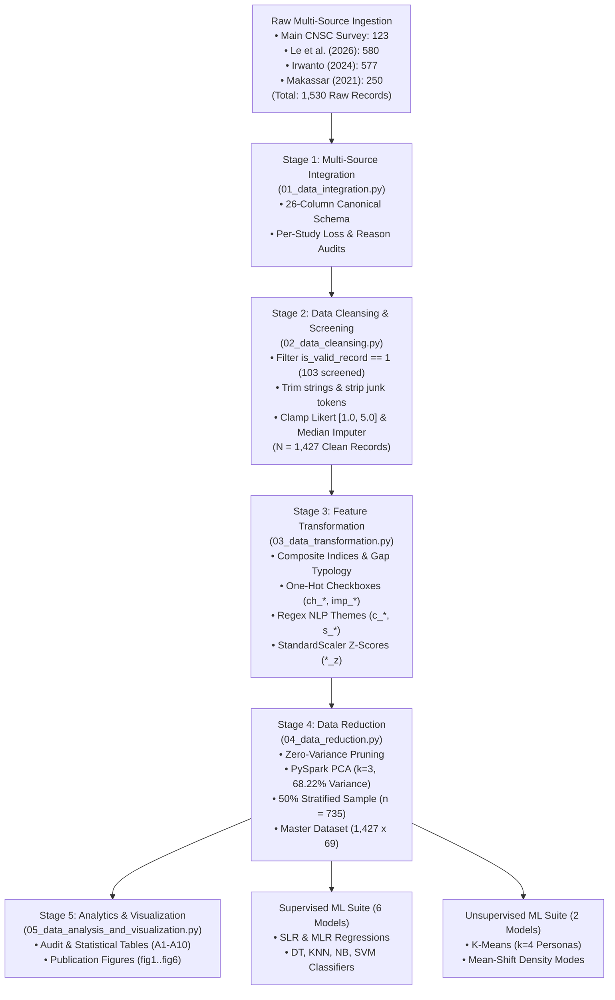

# CHAPTER III: METHODOLOGY

**Study Title:** *Perceptions of College Students Toward Blended Learning as a Response to Power Fuel Crisis*  
**Course:** BSIT 3A – IT 119: Data Scalability and Analytics  
**Researchers:** Johann Jethro O. Chavez, Mikylla Nicole M. Nañez, Divine Mae S. Ponciano  
**Institution:** Camarines Norte State College (CNSC), Daet, Camarines Norte, Philippines  

---

## 3.1 Research Design

This study employs a **quantitative, descriptive, correlational, and predictive research design**, complemented by **unsupervised persona clustering** and **regular-expression (`rlike`) qualitative text mining** in Apache PySpark:
1. **Descriptive Analysis**: Evaluates respondent demographics, home internet reliability, residence arrangements, and item-level distributions across the 11 canonical 5-point Likert items.
2. **Correlational and Gap Analysis**: Quantifies bivariate Pearson correlations ($r$) and measures the empirical **Crisis–Learning Gap** (`crisis_learning_gap = crisis_index - learning_index`), segmenting respondents into three diagnostic gap typologies (*Aligned*, *Crisis-Effective but Learning-Struggling*, *Learning-Adapted beyond Crisis Rating*).
3. **Supervised Machine Learning**: Trains two regression models (Simple Linear Regression and Multiple Linear Regression) to predict continuous continuation support (`support_continue`) and four classification models (Decision Tree, $K$-Nearest Neighbors, Gaussian Naive Bayes, and RBF-Kernel Support Vector Machine) to classify respondents into discrete support tiers (`Not supportive`, `Neutral`, `Supportive`).
4. **Unsupervised Machine Learning**: Executes centroid-based $K$-Means clustering ($k = 4$ personas evaluated across $k \in [2, 6]$) and density-based Mean-Shift mode-seeking clustering on standardized construct indices.

---

## 3.2 Respondents, Multi-Source Integration, and Sampling

The primary survey was administered via Google Forms to **$123$ undergraduate students** across multiple colleges and academic programs at Camarines Norte State College (CNSC), Daet, Camarines Norte. After screening out $1$ duplicate re-submission and $5$ zero-variance straight-line responses with blank open-ended feedback, **$117$ valid primary records** were retained.

To satisfy big-data scalability requirements and achieve high statistical power, the primary CNSC survey was harmonized with three published, open-access public datasets on blended and online learning in higher education:
1. **Le et al. (2026)**: $580$ raw $\to$ $508$ valid undergraduate records from eight universities in Vietnam (Mendeley Data DOI: `10.17632/tdsspksw83.1`).
2. **Irwanto (2024)**: $577$ raw $\to$ $573$ valid undergraduate self-regulated blended learning records from Indonesia (Mendeley Data DOI: `10.17632/7bsvck73ng.1`).
3. **Universitas Negeri Makassar (2021)**: $250$ raw $\to$ $229$ valid Indonesian undergraduate online/blended learning records (Mendeley Data DOI: `10.17632/8myyf5t45z.3`).

Combining all four sources yields **$1,530$ raw records** and **$1,427$ cleaned, topic-valid records** ($103$ screened rows logged with exact attrition reasons).

---

## 3.3 Five-Stage Apache PySpark Data Processing Pipeline

All data engineering was executed in `code/data-cleaning/` using **Apache PySpark 4.2.0**:

### 3.3.1 Stage 1: Multi-Source Data Integration (`01_data_integration.py`)
Harmonizes raw files into the 26-column `UNIFIED_CANONICAL_SCHEMA`, standardizing `program_group`, `year_level` (`year_num` $\in [1, 4]$), `residence_group`, and `internet_group` (`internet_num` $\in [1.0, 3.0]$), and exports `stage1_integrated_dataset.csv` ($1,530$ rows), `stage1_lost_rows_by_study.csv`, and `stage1_lost_rows_reasons_detail.csv`.

### 3.3.2 Stage 2: Data Cleansing & Invalid Row Screening (`02_data_cleansing.py`)
Filters `is_valid_record == 1` (retaining $1,427$ rows and logging $103$ screened rows to `stage2_cleaning_loss_log.csv`), trims whitespace, clamps all 11 Likert items to $[1.0, 5.0]$, applies PySpark `Imputer(strategy="median")` to impute missing Likert values, strips placeholder junk text tokens, deduplicates on `respondent_id`, and exports `stage2_cleansed_dataset.csv`.

### 3.3.3 Stage 3: Feature Engineering & NLP Theme Coding (`03_data_transformation.py`)
Computes composite indices and categorical segmentations:
$$\text{learning\_index} = \frac{\text{understanding} + \text{stay\_on\_track} + \text{academic\_performance}}{3.0}$$
$$\text{adaptability\_index} = \frac{\text{schedule\_fit} + \text{transition\_comfort}}{2.0}$$
$$\text{crisis\_index} = \frac{\text{reduce\_electricity} + \text{reduce\_fuel} + \text{crisis\_effectiveness}}{3.0}$$
$$\text{crisis\_learning_gap} = \text{crisis\_index} - \text{learning\_index}$$
Encodes 6 binary challenge checkboxes (`ch_*`), `challenge_count`, 5 binary improvement checkboxes (`imp_*`), 6 open-ended challenge themes (`c_*`), 5 open-ended suggestion themes (`s_*`), and $z$-standardized item scores (`*_z`) via `VectorAssembler` + `StandardScaler`.

### 3.3.4 Stage 4: Data Reduction (`04_data_reduction.py`)
Executes zero-variance pruning, applies PySpark `PCA(k=3)` on the 11 $z$-score columns (capturing **$68.22\%$ cumulative variance**: $\text{PC}_1 = 38.76\%$, $\text{PC}_2 = 19.97\%$, $\text{PC}_3 = 9.49\%$), and performs $50\%$ stratified sampling across `support_category` (`seed=42`, $n = 735$), exporting `integrated_master_dataset.csv` ($1,427 \times 69$) and `integrated_master_dataset_sampled50.csv`.

### 3.3.5 Stage 5: Statistical Analysis & Visualization (`05_data_analysis_and_visualization.py`)
Generates cleaning audit tables, descriptive and cross-tabulation tables (`analysis1`..`analysis8` and `A1`..`A10`), `key_insights.txt`, and 6 publication figures (`fig1`..`fig6`).

---

## 3.4 Supervised and Unsupervised Machine Learning Framework

### 3.4.1 Supervised Machine Learning (`code/supervised-ml-algo/`)
Using a $75\%/25\%$ train-test split ($1,070$ train / $357$ test rows, `random_state=42`):
- **Simple Linear Regression (`slr.py`)**: Predicts `support_continue` from `learning_index`.
- **Multiple Linear Regression (`mlr.py`)**: Predicts `support_continue` from `learning_index`, `adaptability_index`, `crisis_index`, `f2f_focus`, `internet_num`, and `challenge_count`.
- **Decision Tree Classifier (`decision_tree.py`)**: Predicts `support_category` (`Not supportive`, `Neutral`, `Supportive`) using Gini impurity (`max_depth=3`).
- **$K$-Nearest Neighbors (`knn.py`)**: Evaluates Euclidean distance classification across $k \in [1, 15]$ on standardized predictors.
- **Gaussian Naive Bayes (`naive_bayes.py`)**: Probabilistic classifier outputting full test-set confusion matrices.
- **Support Vector Machine (`svm.py`)**: RBF-kernel classifier ($C = 1.0$) with 2D PCA decision boundary contour visualization.

### 3.4.2 Unsupervised Machine Learning (`code/unsupervised-ml-algo/`)
- **$K$-Means Clustering (`kmeans.py`)**: Evaluates $k \in [2, 6]$ via Inertia (WSSSE) and Silhouette Coefficient, fitting $k = 4$ student personas on standardized construct features (`learning_index`, `adaptability_index`, `crisis_index`, `f2f_focus`, `internet_num`, `challenge_count`).
- **Mean-Shift Clustering (`mean_shift.py`)**: Non-parametric density mode-seeking algorithm (`estimate_bandwidth(quantile=0.18)`, bandwidth $= 1.8475$) that automatically discovers natural density modes without presetting $k$.
